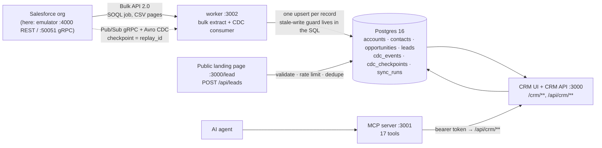

# Explaining this POC to humans

This is the talking document — for the person standing in front of a room, or on a call, who has to
make a Salesforce-migration proof of concept *understandable*: the narrative, the analogies, the
whiteboard, the demo order, and the answers to the objections this POC genuinely invites.

It is not the reference manual ([`ARCHITECTURE.md`](ARCHITECTURE.md) plus
[`CONTRACTS.md`](CONTRACTS.md)) and not the presenter runbook ([`DEMO.md`](DEMO.md), which owns every
command). When this document and a command disagree, the command wins. Every number below was read
from a document in this repo, from a log, or from the live stack. Where a number is a range, it is a
range that was observed.

---

## 1. The 30-second version

There is a small, working CRM in this repo: a Postgres database, a web app a sales team could see, a
public page where a stranger becomes a lead, and an AI agent interface. It gets its data out of
Salesforce two ways — a bulk read of everything, and a live feed of changes that lands in tens of
milliseconds. Salesforce is still the boss: every row that came from Salesforce carries its Salesforce
id and says so. What we proved is that the *pipes* work, that nothing gets silently lost when they
break, and that a lead can be captured and worked entirely without Salesforce in the picture.

The sentence that frames everything else:

> **Salesforce stays the source of truth; we prove we can leave it.**

Say it before any diagram and again at the end. The POC never claims to have migrated anything — it
claims to have demonstrated the route out, at a scale where every failure mode is visible on one
screen.

---

## 2. The 3-minute version — five capabilities, in argument order

The order matters. Lead capture first, because nobody doubts it and it buys credibility. Then the agent
interface, which is the part people find interesting. Then the two hard ones — migration and CDC —
where the doubt lives. Put the hard parts last, when the room has seen the system do something real.

### 1. Public lead capture — "the business workflow that needs no Salesforce at all"

**What it proves:** a visitor becomes a CRM lead without an admin API, without a batch job, without
Salesforce. The public endpoint validates, rate limits, deduplicates, writes straight to Postgres.

**The number:** `201` on a new lead, `200` with `duplicate:true` and the *same* id on a repeat email —
one row either way. Two concurrent identical submissions still produce one row: the dedupe is
`pg_advisory_xact_lock(hashtext(lower(email)))` inside a transaction, not check-then-write. Live now:
`leads` holds `3` `source='salesforce'` rows and `1` `source='landing_page'` row, side by side.

**The sentence:** "This is the smallest possible unit of 'not Salesforce' — and it is already running."

### 2. MCP — "an AI agent is a client of the CRM, with a token"

**What it proves:** there is a clean, authenticated, schema-validated surface for agents: `17` tools
over Streamable HTTP, no SQL in the MCP layer, no path to the database except through the CRM API.

**The number:** `tools/list` returns exactly `17`; `POST /mcp` with no bearer token returns `401`
*before* any CRM call is attempted. The live health check reads `{"status":"ok","tools":17}`.

**The sentence:** "The agent gets the same contract a human UI gets — and the same permissions problem
we have not solved yet."

### 3. Bulk migration — "we can read the whole org out, idempotently"

**What it proves:** a Bulk API 2.0 query job is driven end to end — SOQL in the create body, poll to
`JobComplete`, CSV pages via `Sforce-Query-Locator` — landing as rows keyed on the Salesforce id, with
relationships resolved to local foreign keys.

**The number:** `read=19 applied=19 skipped_stale=0 ignored=0 errors=0` in `2,505 ms`, `613–642 ms`
per object (Account 4, Contact 6, Opportunity 6, Lead 3). Run it twice; row counts do not move.

**The sentence:** "Re-running the migration is free. That is what makes a phased cutover possible."

### 4. CDC — "Salesforce changes, the CRM follows, in milliseconds"

**What it proves:** a real gRPC stream, real Avro decoding, a checkpoint in Postgres, and a guard so
an older snapshot cannot overwrite a newer row.

**The number:** `latency_ms=23` on an update, `0–28 ms` across hundreds of events, measured from the
Salesforce `ChangeEventHeader.commitTimestamp` to the write — stored on the event, not estimated.

**The sentence:** "The CRM is not a nightly copy. It is the same data, a few milliseconds later."

### 5. Recovery and the poison event — "the part everyone asks about last"

**What it proves:** three failure stories with answers. The consumer dies and replays from its
checkpoint with no duplicates (`1,006–1,105 ms` for the event that had to wait). An event *cannot* be
applied, and the system refuses to step over it: three retries at 250 ms / 1 s / 3 s, then that topic
blocks, `[cdc][ALERT]` fires, the checkpoint holds its old `replay_id`, and nothing behind it is lost.
Then an operator fixes the data and `POST :3002/run/redrive` drains it.

**The number:** after redrive, `{"attempted":1,"applied":1,"still_failing":0}` and the checkpoint
returns to `connected` with the *new* replay id. The block is re-derived from `failed` rows on every
subscribe, so a bare reconnect cannot make an incident disappear.

**The sentence:** "We chose a visible stall over a silent loss — and the stall is a database row, not
a log line." Close with: "Four of these are plumbing. The fifth decides whether a migration is safe,
and it is where we spent the care."

---

## 3. Whiteboard script

One marker, ninety seconds. Draw in this order, talk while you draw, never complete the drawing before
you have spoken.

**First — before any box — write two things in the middle of the board.**

```text
source='salesforce'   + salesforce_id  →  Salesforce still owns this row
source='landing_page' + NULL id        →  we own this row, and always did
checkpoint = replay_id  (in Postgres; survives a restart)
```

Say: "Everything else on this board is implementation. These three lines are the design." The
`source`/`salesforce_id` pair is what makes each cutover phase one SQL predicate; the checkpoint is
what makes a dropped connection a non-event.

**Then the boxes, in this order.**

1. **Salesforce**, top-left, labelled "org (here: emulator)". Say immediately: "The left box is a local
   emulator in this repo, not an org. I will come back to that." Getting ahead of it removes the first
   objection before it is raised.
2. **Two arrows out of Salesforce** — one solid, one dotted. Solid: "Bulk API 2.0, whole objects, SOQL
   job, CSV pages." Dotted: "Pub/Sub gRPC, Avro, one event per change — dotted because it is
   continuous."
3. **Worker**, between Salesforce and the database, straddling both arrows: "One process, two
   pipelines, plus a control port so a test or a demo can trigger a run."
4. **Postgres**, centre. Write the four entity tables, then `cdc_events`, `cdc_checkpoints`,
   `sync_runs` smaller underneath: "The checkpoint lives here. So does every event we ever received,
   applied or not."
5. **The write arrow into Postgres**, labelled "one upsert per record — the guard is in the SQL".
   Underline "in the SQL": "not in application code, because two processes can race."
6. **CRM UI**, right of Postgres: "Server components call the same domain functions the worker calls.
   One business-logic layer, so the guard cannot be forgotten in one of them."
7. **Public form**, below the UI, arrow to Postgres and *not* through the UI: "This arrow skips
   everything on the left. That is the point of it."
8. **MCP**, top-right, from an "AI agent" box, arrow into the CRM API: "bearer token, then the same
   endpoints the UI uses. No SQL here."

**The sketch, reproducible on a slide:**



**What NOT to draw. This list matters more than the drawing.**

- **No queue, no broker, no Kafka, no outbox.** None exists here; drawing one to look modern is the
  fastest way to lose the room on the first follow-up.
- **No cloud icon.** Nothing runs outside Docker Compose on one machine.
- **No arrow back from the CRM to Salesforce.** There is no reverse sync; it is a Phase 4 item in
  [`FINDINGS.md`](FINDINGS.md) §5, not a box you can point at.
- **No Salesforce-side automation** — flows, triggers, validation rules. Not modelled, not migrated.
- **No security zones or identity provider.** One bearer token, no user model; a perimeter implies a
  permission story that does not exist.
- **No microservice mesh.** Five containers, one worker. It should look small, because it is.

**Timing guide — 30 seconds per box.** Seven beats, ninety seconds drawing, two to four minutes of
talking.

| Beat | Sec | The line that buys the time |
|---|---|---|
| The written lines | 30 | "These three lines are the design; the rest is plumbing." |
| Salesforce box + honesty | 30 | "The left box is an emulator — I will come back to that." |
| Two arrows | 30 | "One reads everything, one hears every change." |
| Worker | 30 | "One process, two pipelines, one control port." |
| Postgres + guard | 30 | "The guard is in the SQL because two processes race." |
| UI + public form | 30 | "Same domain functions. The form skips the left half." |
| MCP + agent | 30 | "Same contract, and the permission problem we have not solved." |

---

## 4. Five analogies, each with its limit

An analogy you cannot break is a sales pitch. State the limit out loud: it makes the explanation
trustworthy, and it pre-empts the objection you were going to get anyway.

### 4.1 The checkpoint is a bookmark in a book you are still reading

**The analogy.** You do not re-read from page one, and you do not guess where you were. You put a
bookmark in; if you drop the book, you open at the bookmark. Here it is `cdc_checkpoints.replay_id` in
Postgres, so a restarted worker re-subscribes with `preset=CUSTOM` from that id and receives
everything after it — exactly what the logs show after a killed stream:
`subscribed … preset=CUSTOM replay=1795653255416179`.

**Where it breaks.** A bookmark is unlimited; this rewind is bounded by Salesforce's 72-hour Pub/Sub
retention. Down longer than that, the bookmark points at a page the publisher has thrown away and
replay silently cannot reach the missing events. The mock does not model it — it keeps a 1,000-event
in-memory ring buffer that never expires. The mitigation is an alert on checkpoint age plus a bulk
extract as recovery, not a deeper bookmark.

### 4.2 CDC is a subscription, not a trip to the newsstand

**The analogy.** Polling is driving to the newsstand every five minutes to ask whether anything
happened; a subscription is the paper arriving. We subscribe to four topics over gRPC, Salesforce
pushes Avro-encoded events, the worker decodes and applies them. Idle cost zero, latency is the
transport's.

**Where it breaks.** A subscription piles papers up while you are away; this one has a 72-hour returns
policy and a `num_requested` cap of 100 events per batch. Worse, in *our* design a topic that cannot
apply one event stops delivering that topic entirely — deliberately. A newspaper does not stop because
you did not read Tuesday's. And because the mock never expires anything, "no loss over a long outage"
is an argued claim, not a tested one.

### 4.3 The stale-write guard means the newer letter wins

**The analogy.** Two letters about the same deal land out of order. You do not read them in arrival
order; you read the postmark. The upsert compares the incoming `salesforce_updated_at` against the
stored one *inside the SQL statement*:

```sql
WHERE EXCLUDED.salesforce_updated_at IS NOT NULL
  AND EXCLUDED.salesforce_updated_at >= COALESCE(opportunities.salesforce_updated_at, 'epoch'::timestamptz)
```

`>=` rather than `>` so a replay at the identical timestamp still writes. A letter with no postmark
may only start a new pile; it can never overwrite one that exists.

**Where it breaks.** Two ways, both real. First, DELETE is guarded only when the caller passes the
event timestamp, and the CDC consumer calls `deleteSalesforceRecord` with two arguments — so a
late-arriving DELETE is unguarded (open finding P1-2). Second, the guard is a comparison, not a merge:
if two systems write different fields at different times, one write wins the whole row. No field-level
merge, no conflict UI.

### 4.4 Redrive is a dead-letter tray by the door

**The analogy.** Mail that cannot be delivered is not shredded and not jammed into the slot until the
door breaks. It goes in a tray, visibly. An event that fails three times becomes a `cdc_events` row
with `status='failed'`, its payload and its error intact; the checkpoint refuses to advance; the
topic's stream is cancelled; `[cdc][ALERT]` fires. Fix the data, `POST /run/redrive`, and the tray
empties: `{"attempted":1,"applied":1,"still_failing":0}`.

**Where it breaks.** A real DLQ usually drains itself and sits behind alerting. Ours does neither,
on purpose: an automatic retry loop would hide an unmapped picklist value forever. No paging, no
attempt counter on the row, no escalation — a log line and a scheduled endpoint. And
`POST /run/discard` is genuine, permanent abandonment: the row stays `ignored` for audit, but the
record described is *not* updated. Anyone holding `CRM_API_TOKEN` can do that today.

### 4.5 The mock is a flight simulator

**The analogy.** You do not certify a procedure in a real aircraft with passengers; you fly it in a
simulator: same flows, same checklists, same failure drills, no weather, no passengers.
`apps/salesforce-mock` implements the published Bulk API 2.0 query-job contract, a byte-compatible
subset of the `forcedotcom/pub-sub-api` proto, and real Avro CDC payloads with the real
`ChangeEventHeader`. Testing the *procedure* in a simulator is not cheating — it is the only way to
test a procedure you cannot safely crash repeatedly.

**Where it breaks — and this is the important part.** The simulator is not independent: the team that
wrote the client wrote the emulator, so their agreement is not validation. That is exactly how the
Bulk path came to speak an invented dialect — client and mock agreed with each other and disagreed
with the product (audit P0-1, since fixed). Any claim of the form "the client and the mock agree" is
worth nothing. And the simulator has no weather: no OAuth against an External Client App, no
field-level security, no record types or dependent picklists, no concurrent-job limits, no 15-minute
job expiry, no 72-hour retention — eleven unverified areas, listed in [`FINDINGS.md`](FINDINGS.md) §2.

**The rule that follows.** Never say "it works with Salesforce". Say "it works against a faithful
emulator of the published contract, and these org-specific behaviours are unverified". Compress that
and you have made a claim the audit would have caught.

---

## 5. Audience-specific tracks

| Audience | Cares about | Show | Skip | Question they will ask | Answer |
|---|---|---|---|---|---|
| **Engineer** | Is this real code or slides? Where are the sharp edges? | The guard in SQL (`packages/core/src/ingest.ts`), the `cdc.ts` retry-then-block ladder, `event_id` uniqueness, `28 files / 218 tests` (5 skipped, ~25 s) | Business framing; ORM debates; anything with the word "synergy" | "Where does this break?" | Three places, written down: an out-of-order DELETE is unguarded (P1-2); a bulk run killed mid-flight leaves `running: true`; the limiter is per-process memory. [`FINDINGS.md`](FINDINGS.md) §3 is the list — written after an audit that found three P0s. |
| **Tech lead / architect** | What is the boundary, and what does it cost to hold? | The two structural rules: one business-logic layer, Salesforce isolated in `packages/salesforce`. The `source`/`salesforce_id` predicate. The six phases. | Tool-by-tool tour; UI detail; demo prompts | "Why not buy a connector or use AppFlow?" | Because the deliverable is the checkpoint and the per-event audit row, not the transport. AppFlow's Salesforce source uses a fixed 10 MB event buffer where events might be dropped, keeps no per-record replay bookkeeping, and holds transforms in a console, not in git. We are not trading a loss window we cannot see for OAuth plumbing we saved. |
| **Product owner** | What can my team do Monday that they could not Friday? | The landing page and its 201/200/400/429 states; the lead in `/crm/leads` with a green `Website` badge; the agent changing a status and the page following | Bulk wire details; Avro; checkpoint semantics | "So a lead can be worked without Salesforce today?" | Capture, dedupe, list, search, status change, report — yes. Missing is the long tail: accounts and contacts are create-and-read only in the UI, and there is no notion of *who* may see which record. |
| **Executive** | What did we de-risk, and what does it cost to finish? | The five-capability table with measured numbers; the ~26-week path; one reversible pointer per phase | Any code; any analogy needing a second sentence; the mock caveat before the value | "Can we turn Salesforce off in six months?" | Aggressive but plausible for this object model with 1–3 engineers: phases at weeks 1–4, 4–8, 8–14, 14–19, 19–24, then decommission at 24–26 with Salesforce frozen rather than deleted. Schedule risk is discovery — every field, report and integration — not code. |
| **Security / compliance** | Identity, data at rest, audit, blast radius. | `401` before any CRM call; constant-time bearer comparison; parameterised SQL; PII-free logs (email hashed); the honeypot; the mock bound to `127.0.0.1` | Latency numbers; the timeline | "Who can see a lead's record, and who owns that decision?" | Nobody yet — the honest answer. One bearer token, no user model, no sharing rules, no field-level security; `cdc_events.payload` keeps whole records as `jsonb` with no retention policy. Mapping profiles and FLS to internal RBAC is a Phase 0 deliverable with a named client-side owner. |

---

## 6. Objection handling

**6.1 "Isn't the mock cheating?"** It would be, if we claimed fidelity we do not have. We claim
narrower: the *published wire contracts* are implemented and exercised end to end, with real gRPC,
real Avro, real SQL and real HTTP — no org-specific behaviour. The suspicion was earned: an audit
found the bulk client and the mock had agreed on an invented dialect, both wrong together (P0-1). It
was fixed to the real contract and the mock now answers `404` for the invented endpoints. Best argument
for the mock being honest: it has already been caught and corrected. → [`FINDINGS.md`](FINDINGS.md) §2,
[`AUDIT.md`](AUDIT.md) P0-1.

**6.2 "Why not just use AppFlow / EventBridge / a connector?"** All credible, none is what this POC
tests. AppFlow is scheduled or CDC with a fixed 10 MB event buffer where the vendor's own quota page
says events might be dropped on surges; transforms live in a console rather than in git; flows consume
the org's API limit. Event Relay is GA but needs a Hyperforce org, an AWS account, IAM trust and a
partner event source you activate yourself. A connector is a subscription to someone else's mapping
decisions. The thing we must own is the checkpoint and the per-event audit row — the piece none of
them hands you. → [`AI-ACCELERATORS.md`](AI-ACCELERATORS.md) §5–§6.

**6.3 "Doesn't Salesforce CDC already do this?"** CDC is what *produces* the events; we consume them.
It does not apply them to your database, keep your resume point, or decide what happens when an event
cannot be applied. Its retention is 72 hours and `num_requested` is capped at 100 per batch, so "it is
in Salesforce" is not a durability story for your copy. Our contribution starts when the event arrives.

**6.4 "What happens when two writers disagree?"** The newer postmark wins, decided in one SQL
statement so two processes cannot race: `>=` against the stored `salesforce_updated_at`, inside
`ON CONFLICT`, under Postgres' row lock. The known gap, up front: a DELETE gets that comparison only
when the caller passes the event timestamp, and the CDC path does not — so a late DELETE can remove a
newer row (P1-2, one argument at two call sites). And it is whole-row conflict resolution; there is no
field-level merge. → `packages/core/src/ingest.ts`.

**6.5 "What if an event is bad?"** Three retries at 250 ms, 1 s, 3 s; then the event becomes a
`failed` row keeping payload and error, the checkpoint stops at that replay id, that topic's stream is
cancelled, `[cdc][ALERT]` prints. Its topic stalls; the other three keep flowing; nothing behind it is
lost, because the replay re-delivers it. Then an operator fixes the data and redrives, or deliberately
discards — the row stays `ignored` for audit and the record is *not* applied, on purpose and on the
record. The cost, stated: one poison record stops all changes on its topic until a human acts, and
there is no paging today. → [`FINDINGS.md`](FINDINGS.md) §3, Demo 6.

**6.6 "Why not Kafka?"** Because Kafka solves a problem we do not have yet and hides one we do. A
Postgres outbox with `SELECT … FOR UPDATE SKIP LOCKED` handles the work distribution this scale needs;
a broker adds operational surface without a replay guarantee that beats `cdc_events` +
`cdc_checkpoints`. What we lack is not a log — it is backpressure, cross-process retry survival and an
escalation path, which production needs with or without a broker. → [`FINDINGS.md`](FINDINGS.md) §4
rows 1–2.

**6.7 "Is MCP just a REST wrapper?"** Largely yes, deliberately — that is the answer, not a
deflection. MCP is a transport and a tool contract, not a data layer. The server holds no SQL, calls
the internal API with its own bearer token, validates every argument with zod, returns
`structuredContent`, and marks read-only tools with `readOnlyHint`. Its value: an agent gets the same
contract a UI does, with schema validation and a scoped credential in front. The interesting problems
— which tools a model picks, what its token may do — are unaffected by the wrapper.
→ `apps/mcp/src/server.ts`, [`CONTRACTS.md`](CONTRACTS.md) §8.

**6.8 "How long until we can turn Salesforce off?"** Not six months of engineering — about six months
of *phasing*, and the calendar risk is discovery. Weeks 1–4 foundations; 4–8 bulk load with Salesforce
authoritative; 8–14 continuous CDC with a daily comparison; 14–19 read paths switched surface by
surface; 19–24 writes moved with reverse sync during a freeze; 24–26 decommission, Salesforce frozen
and read-only rather than deleted. Each phase is reversible: one pointer, scoped by
`salesforce_id IS NOT NULL`. → [`FINDINGS.md`](FINDINGS.md) §5.

**6.9 "What breaks at 10M rows?"** The apply path first: `applySalesforceBatch` issues one statement
per record — correct and slow. Then the extract: polling and CSV paging never ran past 19 records, and
real Bulk jobs expire after 15 minutes. Then re-runs: no `SystemModstamp` high-water mark, so a
re-extract re-reads the world instead of the delta. Then storage: `cdc_events.payload` keeps whole
records as `jsonb` with no partitioning or retention — a performance and a PII problem. It is rows 3
and 9 of the production-requirements table. → [`FINDINGS.md`](FINDINGS.md) §4.

**6.10 "Who owns permissions?"** Nobody, today. One bearer token with full read/write — no users, no
profiles, no sharing rules, no field-level security. That is not cosmetic: replacing Salesforce means
reproducing *who may see which record*, and the write-path switch is exactly where that changes hands.
The plan is to map profiles and permission sets to internal RBAC and enforce field visibility in the
API layer — Phase 0, with a named client-side owner and a permission-matrix comparison as a gate. If
this cannot be answered with a name before Phase 4, that phase does not start.
→ [`FINDINGS.md`](FINDINGS.md) §4 row 8, §5 Phase 4.

---

## 7. Demo choreography

Six demos exist; [`DEMO.md`](DEMO.md) owns every command, expected output and reset. This is only
*what to show when*, in what order, and what to have already run.

The two moments that land hardest, in any slot:

- **A CDC update visible in tens of milliseconds.** Row before, `POST /mock/emit`, row after,
  `latency_ms=23` in `cdc_events`. The number is stored on the event, not estimated — say that.
- **An AI agent flipping a lead's status and the page changing.** `update_lead_status` → `contacted`,
  then the same lead rendering *Contacted* in `/crm/leads`, in the UI a human uses.

| Slot | Show, in this order | Pre-run so it is instant | Cut |
|---|---|---|---|
| **5 minutes** | Demo 4 (public lead: 201 / duplicate / 400) → Demo 5b (MCP `update_lead_status`, then the page) | Stack up and migrated; one landing-page lead already in the table; `get_sales_summary` warmed once so Next is compiled | Demos 1, 2, 3, 6. Give the migration and CDC numbers verbally, doc open. |
| **15 minutes** | Demo 1 (bulk, 19 records, re-run for idempotency) → Demo 2 (CDC, 23 ms) → Demo 4 (public lead) → Demo 5b (agent writes, page reflects it) | A bulk run already done so counts are non-zero; worker logs tailing in terminal A; one `psql` session on `cdc_events` | Demos 3 and 6 — offer them as "the failure story, if you want it". Someone always does. |
| **30 minutes** | All six in order: 1 → 2 → 3 → 4 → 5a or 5b → 6, with the reset between segments | Everything above plus: mock at canonical `4/6/6/3`, zero `failed` events, four checkpoints `connected`, an AI client already configured against `:3001` if you plan 5a | Nothing. If time runs out, protect Demo 6 — it is the argument. |

**Order is not negotiable.** Bulk before CDC (you cannot watch a change land in an empty table), CDC
before recovery (replay means nothing without a stream), recovery before the poison event (clean
failure before blocked failure), lead capture and MCP last so the room leaves on the business story.
Compress depth, never sequence.

**The reset between segments** is [`DEMO.md`](DEMO.md) §"Reset between demos": restart the mock,
truncate `cdc_events` / `cdc_checkpoints` / `sync_runs` / the three Salesforce tables and non-landing-page
leads, re-run bulk. Two warnings to say out loud, because both look like bugs:

- **Never restart the mock without truncating the CRM.** The re-seed carries 2024 timestamps, so the
  guard correctly refuses to overwrite rows a previous emit stamped with 2026 — `skipped_stale: 2` and
  two stuck rows. That is the guard working.
- **Never start with the worker blocked.** If a `failed` event remains, the checkpoint stays
  `status='error'` and Demo 2 appears to do nothing.

Reset takes ten seconds; do it even when the data looks right, and have terminal A tailing worker logs
first.

---

## 8. The honest closing

Three sentences, in this order, without hedging — then stop talking.

1. **What is proven.** Five capabilities work end to end inside this repo against real Postgres, real
   gRPC, real Avro, real HTTP and real rendered HTML: 19 records extracted idempotently in 2.5 s,
   changes applied in 0–28 ms, a killed stream replayed with no duplicates, a poison event blocked and
   redriven, a stranger captured as a lead without Salesforce, 17 MCP tools behind a bearer token —
   with a 218-test suite asserting all of it.
2. **What is not.** Nothing here has ever spoken to a real Salesforce org. OAuth, field-level
   security, record types, picklist values, Bulk limits, the 72-hour Pub/Sub retention window and a
   real AI client driving these prompts are unverified. The Salesforce side is a faithful emulator,
   written by the same people who wrote the client — which is why one deviation needed an external
   audit to catch.
3. **The next 30 days.** A read-only External Client App in the client's org, a staging deploy doing
   one real bulk extract and one real CDC subscribe, an inventory of every field / record type /
   picklist / report / integration, and the operational half of the CDC story: a worker healthcheck,
   `restart: unless-stopped`, an alert on `failed > 0` and on checkpoint age, a named approver for
   discard.

And the one-sentence answer to "so can we replace Salesforce in six months?", consistent with
[`FINDINGS.md`](FINDINGS.md) §5:

> Yes, for this object model, on a phased schedule with Salesforce frozen rather than deleted at the
> end — because the risky part is not the CRM, it is the boundary: picklist and permission mapping,
> the long tail of reports and integrations, and the guarantee that no change is lost between the two
> systems.

---

## 9. Phrases to avoid, phrases to use

| Avoid | Use instead | Why |
|---|---|---|
| "We migrated from Salesforce." | "We proved a migration path against a faithful emulator." | Nothing was migrated; no org was contacted. |
| "It works with Salesforce." | "It works against the published contracts; org-specific behaviours are unverified." | The sentence the audit would have caught. |
| "Real-time sync." | "Near real-time, with a measured 0–28 ms apply latency." | "Real-time" invites an SLA argument you cannot win. |
| "Exactly once." | "At-least-once delivery, deduplicated on `event_id`." | `event_id` is UNIQUE; the guarantee is dedupe, not magic. |
| "Nothing is ever lost." | "Nothing is silently lost: a poison event blocks its topic and is redriven or deliberately discarded." | Blocking costs freshness; say so. |
| "The mock is Salesforce." | "The mock is a flight simulator for the procedure." | Call it Salesforce once and every claim inherits its gaps. |
| "We'll add Kafka later." | "An outbox with `SKIP LOCKED` is enough at this scale; a broker is §4 row 2, if volume demands it." | Unspecified future architecture reads as a gap, not a plan. |
| "The rate limiter stops abuse." | "The limiter is per-process memory; behind no proxy the per-IP bucket cannot apply, so global and per-email buckets protect the form." | It is demo-grade, and `DEMO.md` already says so. |
| "The AI agent did it." | "The agent called the tool, the tool called the API, and you can see the write in the UI." | Never imply a model was observed doing something it was not. |
| "Security is out of scope." | "There is no user model yet; RBAC and field visibility are Phase 0 deliverables with a named owner." | Out of scope sounds unaware; named owner sounds like a plan. |
| "That finding is fixed." | "That finding is fixed, at this commit, verified by this test." | P1-2 and P1-6 are partially fixed, not fixed. |
