# How it works

The definitive technical walkthrough: what runs, what the data looks like, and exactly what happens on
every write path. Every claim below was read out of the code in this repository, not out of the other
docs. Where code and intent disagree, the code is described.

---

## 1. What the system is

This is a CRM that keeps a working Postgres copy of a Salesforce org and lets people use it. Records
arrive three ways — a Bulk API 2.0 extraction, a Pub/Sub CDC consumer, and a public web form — and all
three write through the same package, `@poc/core`, which owns the single rule that makes the copy
trustworthy: an older snapshot may never overwrite a newer row. Three read/write surfaces sit on top:
Next.js server components that call `@poc/core` in-process, a bearer-token HTTP API under
`/api/crm/**`, and an MCP server exposing 17 tools to AI agents over Streamable HTTP. Salesforce itself
is `apps/salesforce-mock`, an in-process emulator implementing Bulk 2.0 **query** jobs and the
`eventbus.v1` Pub/Sub gRPC API with real Avro payloads — the only Salesforce this system has ever run
against.

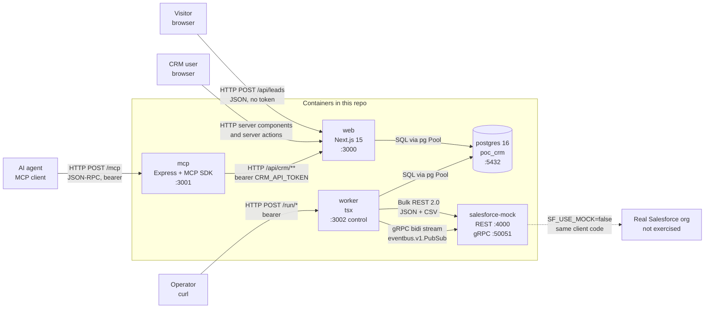

Two structural rules fall out of that graph: `mcp` holds no database credentials, and `packages/core`
holds no Salesforce client. `worker` is the only process importing both `@poc/salesforce` and
`@poc/core`.

---

## 2. Runtime topology

Five long-lived services plus one opt-in `tools` container. All five run the **same image**
(`poc-salesforce-migration/node:latest`, built from the `runtime` stage of `Dockerfile`) with a
different `command`.

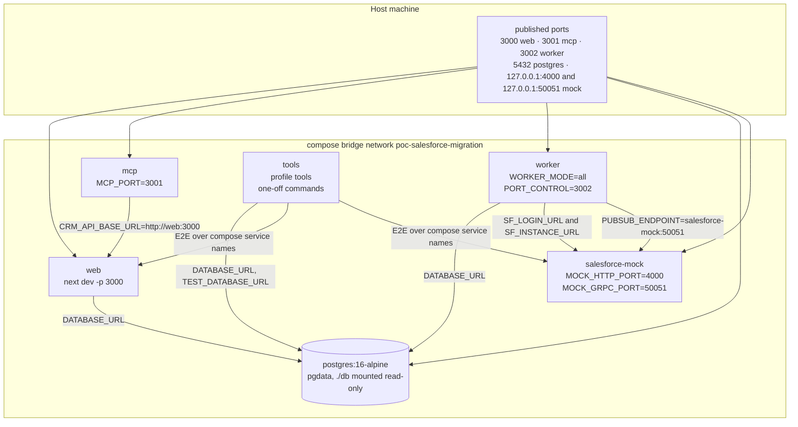

| Service | Purpose | Key files | Published port | Healthcheck |
|---|---|---|---|---|
| `postgres` | Source of truth. First boot applies `001_init.sql` twice: to `poc_crm` and to `poc_crm_test` | `db/migrations/001_init.sql`, `docker/postgres-init.sh` | `5432` | `pg_isready -U poc -d poc_crm`, 3 s, 20 retries |
| `web` | Public lead form, CRM UI, internal CRM API, server actions | `apps/web/app/**`, `apps/web/lib/**` | `3000` | `fetch /api/health` and require `r.ok` — that route runs `SELECT 1`, so a dead DB fails the container |
| `mcp` | JSON-RPC tool surface for AI clients; no SQL | `apps/mcp/src/**` | `3001` | `fetch /health` — open, no auth; it pings the CRM API with the bearer token |
| `worker` | Bulk extraction, CDC consumer, reconcile, operator control plane | `apps/worker/src/index.ts`, `control.ts` | `3002` | `fetch :3002/health` **with the bearer token** — probes the control plane, so a dead consumer cannot be reported `Up` |
| `salesforce-mock` | Emulated org: Bulk 2.0 query jobs, SOQL, Pub/Sub gRPC, `/mock/*` admin | `apps/salesforce-mock/src/**` | `127.0.0.1:4000`, `127.0.0.1:50051` | `fetch /mock/health` |
| `tools` | `docker compose run --rm tools …` for test, typecheck, migrate, vitest, psql | none (uses the image) | none | none |

Operational notes: `4000` and `50051` bind to `127.0.0.1` because `/mock/*` is unauthenticated and can
rewrite the whole dataset; containers still reach it by service name. `init: true` on every node service
is what lets `worker` receive `SIGTERM` at all — otherwise `pnpm` is PID 1 and swallows it. `restart:
"no"` means nothing is supervised, so the healthcheck only makes a crash *visible*, and
`WATCHPACK_POLLING=true` makes file watching work over the bind mount.

### One image, five commands

`Dockerfile` builds `deps` (frozen `pnpm install` from the committed lockfile) then `runtime`
(`COPY . .`, `CMD node -e console.log(...)`), and compose overrides `command` per service with
`pnpm --filter @poc/<pkg> run dev`. The `.` bind mount replaces `/app`, so source is edited on the host
and `tsx watch` / `next dev` reload without a rebuild. That bind mount would also hide the image's
`node_modules`, so every `node_modules` directory plus `apps/web/.next` are **named volumes**
(`x-node-volumes`: `nm_root`, `nm_web`, `nm_mcp`, `nm_worker`, `nm_mock`, `nm_core`, `nm_sf`,
`next_cache`). Docker seeds each empty volume from the image path on first use, so the container sees
the lockfile's tree, not the host's.

Never run `pnpm install` inside a container. Those volumes are shared dependency state and outlive image
rebuilds. An in-container `install` rewrites them with whatever that run resolved: it diverges from the
committed `pnpm-lock.yaml` with no diff to review, it is invisible to the next `docker compose build`
because the volume is already populated and never re-seeded, and it breaks all five services at once.
Recovery is `docker compose down -v`, which also drops `pgdata`. Dependency changes go through the
lockfile: edit `package.json`, run `pnpm install` on the host (or `docker compose run --rm --entrypoint
sh tools -c 'pnpm install --lockfile-only'`), commit the lockfile, rebuild.

---

## 3. Data model

`db/migrations/001_init.sql` is authoritative and idempotent (`CREATE TABLE IF NOT EXISTS`,
`DROP TRIGGER IF EXISTS` before each `CREATE TRIGGER`). To keep it readable the diagram elides the
descriptive columns — accounts `industry, website, billing_country, owner_name`, contacts
`first_name, phone, title`, opportunities `close_date, owner_name, probability`, leads
`phone, company, property_interest, message` — and the `created_at`, `updated_at` (maintained by
`set_updated_at()`) and `synced_at` triple that every entity table carries.

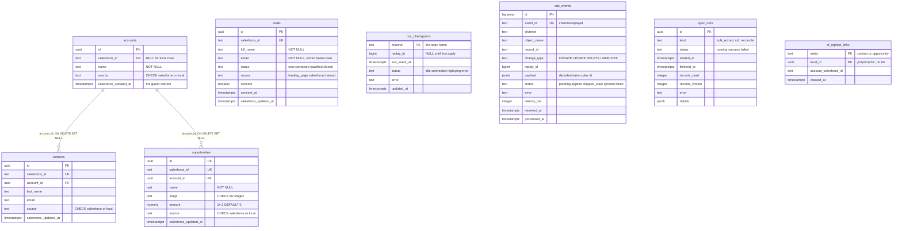

`sf_orphan_links` deliberately has no FK: `local_id` points at `contacts.id` or `opportunities.id`
depending on `entity`, and `linkOrphanRecords()` prunes dangling rows.

### `source` vs `salesforce_id`

They answer different questions and both are needed:

| Row | `salesforce_id` | `source` | Who owns it |
|---|---|---|---|
| Imported from Salesforce | set (`001…`, `006…`) | `salesforce` | Salesforce. The CRM copy is downstream. |
| Captured on the landing page | `NULL` | `landing_page` | The CRM. Never existed in Salesforce. |
| Created in the CRM UI / MCP / API | `NULL` | `local` (accounts, contacts, opportunities), `manual` (leads) | The CRM. |

Two properties follow from the schema. `salesforce_id` is `UNIQUE` but nullable, and Postgres allows
many `NULL`s in a unique index — so a local account and a Salesforce account with the same name are two
rows, no `ON CONFLICT` ever matches a local row, and there is no name merge or email uniqueness. And
`source` cannot drift: every upsert assignment list force-sets `source = 'salesforce'`, `createAccount`
hard-codes `'local'`, `createLead` defaults to `'landing_page'`, and the `CHECK` constraints make a
third value impossible.

### Why replay ids are `bigint` in Postgres and strings in JSON

Mock replay ids are `Date.now() * 1000 + n` (≈1.8e15 today) and grow monotonically; real ones are
64-bit and can exceed `Number.MAX_SAFE_INTEGER` (9.007e15). A JS `number` would round, two events would
hash to the same `event_id`, and one would be dropped as a duplicate. So:

- `cdc_checkpoints.replay_id` and `cdc_events.replay_id` are `bigint`; `cdc_events.id` is `bigserial`.
- Everything crossing a JS/JSON boundary is a decimal **string**. `toReplayId()` accepts
  `bigint | number | string`, rejects anything not matching `/^-?\d+$/` with `validation_error`, and
  returns a string; `rows.ts` maps with `bigintString()`; the gRPC wire form is 8-byte big-endian
  (`encodeReplayId` / `decodeReplayId`). Node-postgres returns `int8` as a string by default and
  `db.ts` installs no type parser, so nothing is ever coerced to a float.

### What each index is for

| Index | Why it exists |
|---|---|
| `accounts_name_idx` on `lower(name)` | Accounts list orders by `lower(a.name) ASC, a.id ASC`. `ILIKE '%…%'` cannot use it; the sort can. |
| `accounts_source_idx` | `?source=salesforce` filter and the `source` counts in `getSalesSummary`. |
| `contacts_account_idx`, `opportunities_account_idx` | Account detail pages. |
| `contacts_email_idx` on `lower(email)` | Email lookups; storage lower-cases, so the expression index matches. |
| `opportunities_stage_idx` | `?stage=` filter and `getOpportunitiesByStage`'s `GROUP BY stage`. |
| `leads_email_idx` on `lower(email)` | The duplicate probe in `findOrCreateLandingLead` and `getLeadByEmail`. |
| `leads_status_idx`, `leads_source_idx`, `leads_created_at_idx` on `created_at DESC` | List filters, the `getLeadSummary` groups, the default `created_at DESC, id DESC` ordering, and the 24 h duplicate window. |
| `sf_orphan_links_account_idx` | `linkOrphanRecords()` joins pending links on `accounts.salesforce_id`. |
| `cdc_events_channel_idx` on `(channel, replay_id DESC)`, `cdc_events_record_idx` on `(object_name, record_id)` | Per-channel replay ranges and per-record history. |
| `cdc_events_received_idx` on `received_at DESC` | `listCdcEvents()` ordering, which the sync dashboard renders. |
| `sync_runs_started_idx` on `started_at DESC` | `listSyncRuns()`. |

One honest gap: there is **no index on `cdc_events.status`**, yet the block-detection path runs
`listCdcEvents({status:'failed', limit:200})` on every reconnect — a sequential scan. Fine at demo
volume; the first thing to index if the event log grows.

---

## 4. The stale-write guard

The most important correctness property of the migration. A bulk extract that started before a CDC
event can finish after it; without a guard the older full snapshot overwrites the newer change and the
local copy silently regresses.

### The actual SQL

`buildUpsert()` in `packages/core/src/ingest.ts` emits one statement per record:

```sql
INSERT INTO opportunities (name, account_id, stage, amount, close_date, owner_name,
                           probability, salesforce_id, source, salesforce_updated_at, synced_at)
VALUES ($1, $2, $3, $4, $5, $6, $7, $8, $9, $10::timestamptz, now())
ON CONFLICT (salesforce_id) DO UPDATE SET
  name = EXCLUDED.name,
  … one assignment per mapped column …
  salesforce_updated_at = EXCLUDED.salesforce_updated_at,
  source = 'salesforce',
  synced_at = now()
WHERE EXCLUDED.salesforce_updated_at IS NOT NULL
  AND EXCLUDED.salesforce_updated_at >= COALESCE(opportunities.salesforce_updated_at, 'epoch'::timestamptz)
RETURNING id
```

That is a fully populated opportunity; the placeholder numbering shifts with the columns the mapper
produced. `$9` binds the literal string `'salesforce'` for `source`, and the stamp placeholder is the
only one that carries an explicit `::timestamptz` cast.

The `WHERE` belongs to the `DO UPDATE`, so it is evaluated under the row lock Postgres already holds for
the conflicting row. Four details are load-bearing:

- **`>=`, not `>`.** A replay at an equal stamp still writes, which is what makes re-extraction
  idempotent instead of "changed nothing but reported `skipped_stale`".
- **`COALESCE(…, 'epoch')`.** A stored `NULL` means "inserted by a timestamp-less record"; without it
  the comparison yields `NULL` and the first timestamped record silently would not apply.
- **The stamp is assigned inside the guarded branch**, which already required a non-null incoming stamp,
  so `salesforce_updated_at` can only move forward.
- **`WHERE` false is not an error.** No row is returned, so `upsertSalesforceRow()` runs one cheap
  follow-up `SELECT id … WHERE salesforce_id = $1`: row found with a stamp → `skipped_stale`; row found
  with no stamp → `ignored` / `missing timestamp`; no row → `ignored` / `no row written`.

### Two concurrent snapshots

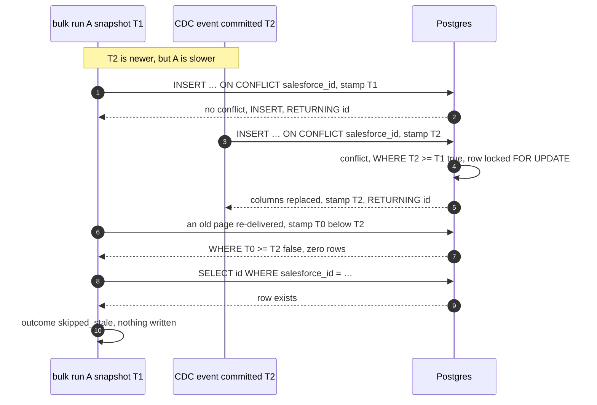

The classic interleaving — A's `ON CONFLICT` lands *after* B's — is decided by the same comparison:
`T1 >= T2` is false, so A writes nothing and reports `skipped_stale`.

### The missing-timestamp rule

`recordTimestamp()` resolves the incoming stamp as `SystemModstamp` → `LastModifiedDate` →
`ChangeEventHeader.commitTimestamp` → `null`. When it is `null` the statement inserts
`salesforce_updated_at = NULL`, the guard's first conjunct is false on **any** conflict, and the record
may only INSERT. Against an existing row it is rejected as `{outcome:'ignored', reason:'missing
timestamp'}` and neither its data nor its stamp is touched. A first insert with no stamp is accepted
and leaves `NULL`, which the next timestamped record beats via `'epoch'`. That is the conservative
direction on purpose: an unparseable stamp proves nothing, so it grants no write permission.

### The DELETE guard

```sql
DELETE FROM opportunities
 WHERE salesforce_id = $1
   AND (salesforce_updated_at IS NULL OR salesforce_updated_at <= $2::timestamptz)
RETURNING id
```

Row deleted → `applied`. No row deleted but the row exists → `skipped_stale` (`delete older than local
row`). No row at all → `ignored` (`no local row for salesforce id`). `updatedAt` absent/null → an
unguarded `DELETE … WHERE salesforce_id = $1`, the legacy two-argument behaviour.

Where the guard is actually wired, traced through the code:

| Caller | Call | Guarded? |
|---|---|---|
| `applySalesforceRecord(… 'DELETE', record)` | `deleteSalesforceRecord(object, id, {updatedAt})` with `recordTimestamp(record)` | yes, when a stamp is present |
| `CdcConsumer.handleEvent` (`cdc.ts`) | `deleteSalesforceRecord(objectName, sfId)` — two arguments | **no** |
| `redriveFailedEvents` (`redrive.ts`) | `deleteSalesforceRecord(event.object_name, salesforceId)` — two arguments | **no** |

So the DELETE path is guarded in capability but unguarded on the two paths that actually run it: a
replayed or out-of-order `DELETE` removes the row unconditionally. That is open finding P1-2, and it is
a property of the code as written, not of the comments above it.

### Why the rule lives in SQL and not in application code

- **Atomicity.** Read-then-write in Node is a TOCTOU window spanning `web`, `worker` and any replica;
  here the comparison happens inside one `INSERT … ON CONFLICT`, under Postgres' row lock, in the same
  statement as the write.
- **One implementation, four callers.** Bulk, CDC, redrive and any future backfill all reach
  `buildUpsert()`, so there is no second copy of the rule to keep in sync.
- **The timestamp is data, not process state.** It is stored per row and compared against the stored
  value, so the guarantee survives restarts, crashes and a restored backup.

The visible cost: the guard is only as good as the incoming timestamp, and it is invisible to anyone who
writes to a Salesforce-synced row locally (Section 9).

---

## 5. Flow A — Bulk extraction

`runBulkExtract()` in `packages/salesforce/src/bulk.ts`, driven by `worker` (mode `bulk`, `once` or
`all`) or by `POST :3002/run/bulk`.

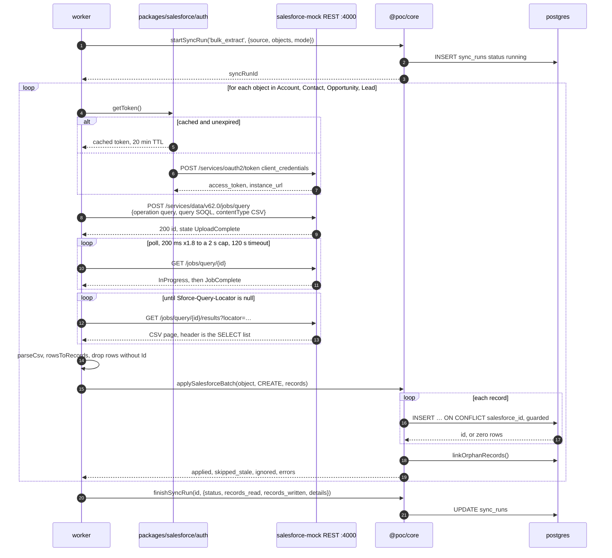

Facts an engineer will trip over if they assume otherwise:

- **The SOQL is the body of the create call.** `createQueryJob` posts `{operation:'query', query: soql,
  contentType:'CSV', columnDelimiter:',', lineEnding:'LF'}`. There is no batch upload; a query job is
  `UploadComplete` as soon as it exists, and the mock answers `404` on `PUT …/jobs/query/{id}/batches`
  and on the whole `jobs/ingest` path rather than accepting the ingest shape.
- **`GET /results` returns exactly the SELECT list and pages by header.** No `sf__Id`; `Id` must be
  selected or `rowsToRecords` drops the row, and `Owner.Name` arrives flattened, which is the key
  `readOwner` reads. `Sforce-Query-Locator` carries the next token, echoed as `?locator=`; the loop
  stops on `null`, absent or empty and hard-stops at `MAX_RESULT_PAGES = 10_000`. The mock pages at
  2 000 rows and `POST /mock/config {queryJobPageSize}` lowers that so concatenation is provable.
- **Object order is the FK order.** `OBJECT_NAMES = ['Account','Contact','Opportunity','Lead']`, so
  `resolveParentAccount()` finds the parent on the first pass; anything missing is parked in
  `sf_orphan_links` and re-linked after the batch.
- **`changeType` is always `'CREATE'`** — an extract is a full upsert and
  `CREATE`/`UPDATE`/`UNDELETE` share one path. **One object failing does not abort the others**: the
  loop catches per object, zeroes that object's counters, and the run is marked `failed` with the
  *first* message. `records_written` is `totals.applied`, so `ignored` and `skipped_stale` only show up
  in `details.objects`.

### The idempotency argument

Re-running an extract is a no-op for three independent reasons: the conflict key is the unique
`salesforce_id`, so each record maps to exactly one row; the guard accepts an equal timestamp, so a
replay at the same stamp rewrites identical values instead of being rejected; and nothing in the
extract deletes. The corollary is that a record deleted in Salesforce *during* the extract window is
never removed by the extract — only a `DELETE` CDC event or a manual reset removes it.

Measured on the running stack: `POST :3002/run/bulk` → `read=19 applied=19 skipped_stale=0 ignored=0
errors=0` in ~2.4 s; a second call returns the same totals and leaves row counts unchanged.

---

## 6. Flow B — CDC

`CdcConsumer` in `packages/salesforce/src/cdc.ts`: four topics in parallel
(`/data/{Account,Contact,Opportunity,Lead}ChangeEvent`), one reconnect loop and one serial queue per
topic. Ordering is guaranteed within a topic and nowhere else.

### Happy path

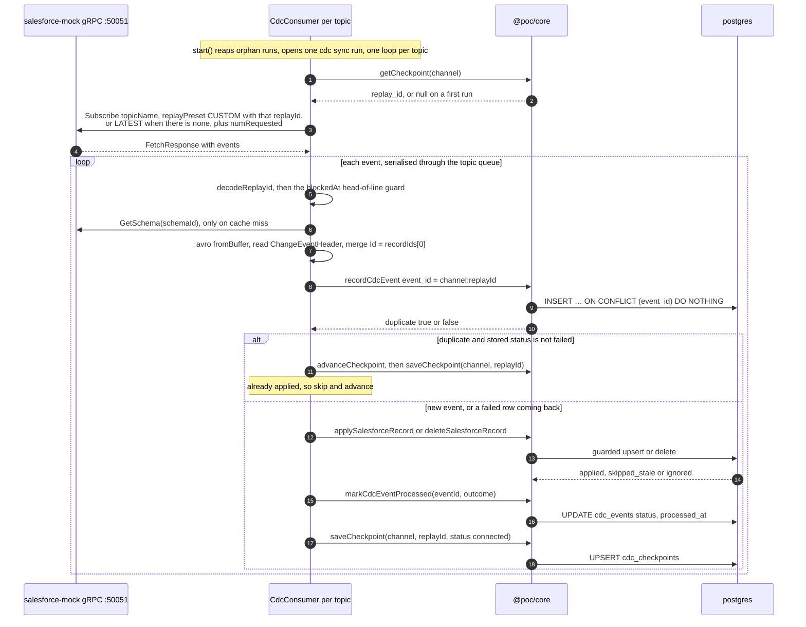

The order is the contract and it is strict: **decode → record → apply → mark → checkpoint.** The
checkpoint write is last and is the only thing that makes the consumer forget an event. Anything that
dies between apply and checkpoint re-delivers the event, and `event_id UNIQUE` makes the re-delivery
harmless — at-least-once delivery, effectively-once effect.

Other details worth knowing:

- **Checkpoint channel = topic name** (`channelForTopic` defaults to identity), and `LATEST` vs `CUSTOM`
  is decided per subscribe from the row: `previous > 0n` selects `CUSTOM` with that replay id, otherwise
  `LATEST`. Resume therefore needs no process memory — only `cdc_checkpoints.replay_id`.
- **Flow-control credit.** `numRequested` (default 100, `PUBSUB_NUM_REQUESTED`) is sent on subscribe and
  replenished with `{topicName, numRequested: events.length}` after each batch. A real org stops sending
  without it; the mock ignores it and echoes `pendingNumRequested`.
- **`latency_ms` = `Date.now() − commitTimestamp`**, so it includes reconnect backoff; aggregated per
  `cdc` sync run as p50/max over a reservoir capped at 10 000 samples.
- **One `cdc` sync run per consumer lifetime**, opened on the first subscribe and closed on `stop()` or
  after every topic has been down for 30 s (`CDC_RUN_IDLE_CLOSE_MS`), with `details` carrying per-run
  deltas, latency, `blocked`, `held` and `close_reason`. `reapOrphanSyncRuns()` flips a `running` row
  left by a dead process to `failed` with `close_reason: 'orphaned'`; `worker` calls it once when it
  starts the consumer, and only there — the one place where "every `running` `cdc` run belongs to a dead
  process" holds.

### Failure path — bounded retry, then head-of-line blocking

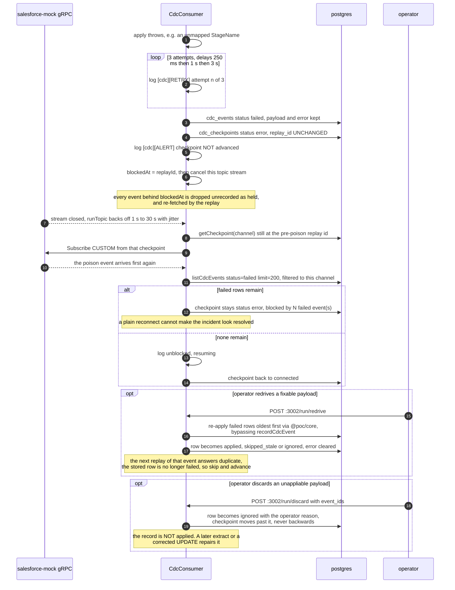

Exact numbers and strings from the code: three attempts (`APPLY_RETRY_DELAYS_MS = [250, 1000, 3000]`,
`APPLY_ATTEMPTS = 3`), one `[cdc][ALERT]` line, checkpoint error text `apply failed after 3 attempts,
checkpoint NOT advanced (blocked at replay=…): …` truncated to 500 chars, and block re-derivation from
`listCdcEvents({status:'failed', limit:200})` filtered to the channel using the **oldest** row (that list
is newest-first, so the last element) as `blockedAt`. While blocked the topic keeps escalating its
backoff instead of resetting it, so a poison event is retried at 1 s → 30 s, not every second; the other
three topics are unaffected.

`POST /run/redrive` answers `{attempted, applied, skipped_stale, ignored, still_failing}` with HTTP 200
even when `still_failing > 0` — a still-broken event is a report, not a transport failure.
`POST /run/discard` answers `{discarded, not_found, checkpoint_advanced}` and `400` on an empty
`event_ids`.

### A CDC event's states

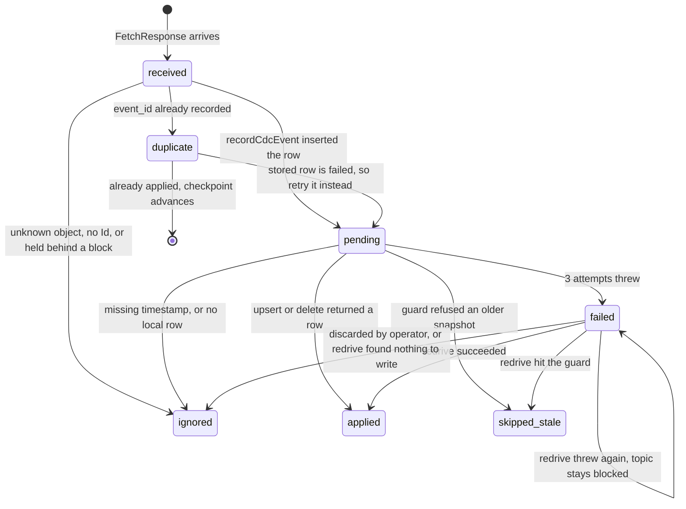

The `status` CHECK allows exactly `pending | applied | skipped_stale | ignored | failed`. "duplicate"
is never stored: the second delivery is not inserted, the existing row is untouched, and the only trace
is `stats.duplicates` plus the checkpoint moving. "discarded" is `ignored` with the audit text
`discarded by operator (event abandoned; the record was not applied)`. "held" is not stored either —
those events are dropped before `recordCdcEvent`, deliberately, so the checkpoint can never jump the
hole.

---

## 7. Flow C — Public lead capture

`POST /api/leads` is the only unauthenticated write in the system
(`apps/web/app/api/leads/route.ts`); the browser form is `apps/web/app/lead/lead-form.tsx`, a client
component that `fetch`es it directly.

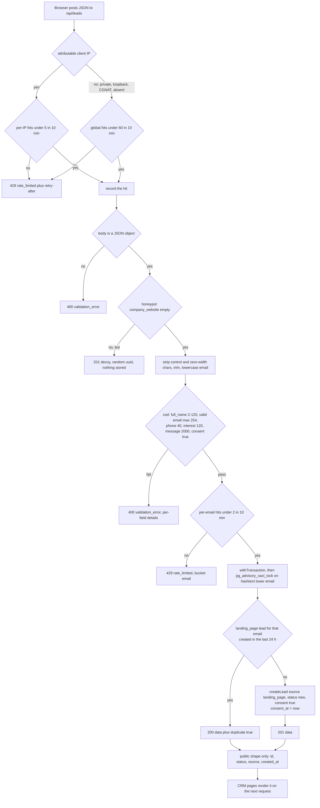

Exact status codes:

| Status | Code | When |
|---|---|---|
| `429` | `rate_limited` | per-IP bucket exhausted (5/10 min) or global bucket exhausted (60/10 min); `retry-after` = seconds until the oldest hit expires |
| `429` | `rate_limited` | 3rd submission for the same email inside 10 min (`EMAIL_MAX_SUBMISSIONS = 2`) |
| `400` | `validation_error` | body is not JSON, not an object, or zod fails; `details` is `{field: message}` |
| `201` | — | honeypot tripped: fake success with a random UUID, nothing written, no email logged |
| `200` | — | duplicate: a `source='landing_page'` lead for that email with `created_at > now() - 24 h`; body `{data, duplicate:true}` |
| `201` | — | created |
| `500` | `internal` | insert failed; generic message, the error goes to the log with only a truncated email hash |

`DUPLICATE_WINDOW_HOURS = 24` is evaluated in SQL as
`created_at > now() - ($3::int * interval '1 hour')`, inside the transaction and under the lock, and
against `source = 'landing_page'` only — a Salesforce lead with the same address does not count, which
is why there is no unique index on email.

`pg_advisory_xact_lock(hashtext(lower(email)))` is the concurrency fix: two simultaneous submissions of
one address serialise, the winner re-checks and inserts, the loser sees the committed row and returns
it with `duplicate: true`. The lock is released by `COMMIT`/`ROLLBACK`, so there is no cleanup path.
`hashtext` is 32-bit, so unrelated addresses occasionally serialise for a millisecond — harmless, never
wrong. This is the one deliberate place where SQL lives in `apps/web` instead of `@poc/core`: the
service layer exposes single-statement operations only, and the lock must wrap both the check and the
insert. The row itself is still created by `createLead`.

The limiter is per-process and in-memory, 10-minute sliding windows (`lib/leads/rate-limit.ts`); it
resets on every hot reload and is not shared across replicas. Compose ships no proxy, so the address
seen here is either absent or an internal bridge/loopback address — both fail `isAttributableIp()`, so
the **global + per-email** limits are the ones actually in force. The `bucket=ip|global` field on every
`[leads]` log line is how you tell which path ran.

---

## 8. Flow D — MCP

`apps/mcp` serves JSON-RPC over the MCP **Streamable HTTP** transport, statelessly. `POST /mcp` is the
only RPC entry; `GET /mcp` gets the transport's `405` because there is no session to stream to.

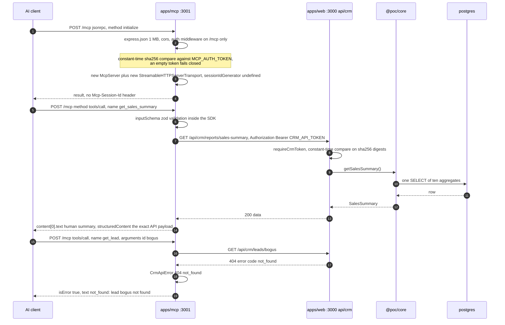

The error path is narrow by design. `runTool()` catches everything and renders `` `${code}:
${message}` `` for a `CrmApiError`, `internal_error: ${message}` for anything else, and `internal_error:
unexpected failure` for a non-Error — no stack, no URL, no token. Transport failures are mapped before
that: `AbortError`/`TimeoutError` → `504 upstream_timeout`, connection failure → `503
upstream_unreachable` (message names only origin and path, never the raw fetch error), non-JSON body →
`502 upstream_invalid_response`. Timeout is 8 000 ms per call.

Statelessness is the design: a fresh `McpServer` + transport per request, closed on `res.close`. No
`Mcp-Session-Id`, no server-initiated stream, safe horizontal scaling — and one consequence worth
stating: every request must carry a full JSON-RPC envelope.

### The 17 tools and the endpoint each one calls

| Group | Tool | Method + endpoint | `readOnlyHint` |
|---|---|---|---|
| accounts | `list_accounts` | `GET /api/crm/accounts` | yes |
| accounts | `get_account` | `GET /api/crm/accounts/{id}` | yes |
| accounts | `search_accounts` | `GET /api/crm/accounts?search=` | yes |
| accounts | `create_account` | `POST /api/crm/accounts` | no |
| accounts | `update_account` | `PATCH /api/crm/accounts/{id}` | no |
| opportunities | `list_opportunities` | `GET /api/crm/opportunities` | yes |
| opportunities | `get_opportunity` | `GET /api/crm/opportunities/{id}` | yes |
| opportunities | `create_opportunity` | `POST /api/crm/opportunities` | no |
| opportunities | `update_opportunity` | `PATCH /api/crm/opportunities/{id}` | no |
| leads | `list_leads` | `GET /api/crm/leads` | yes |
| leads | `get_lead` | `GET /api/crm/leads/{id}` | yes |
| leads | `search_leads` | `GET /api/crm/leads?search=` | yes |
| leads | `update_lead_status` | `PATCH /api/crm/leads/{id}/status` | no |
| reporting | `get_sales_summary` | `GET /api/crm/reports/sales-summary` | yes |
| reporting | `get_opportunities_by_stage` | `GET /api/crm/reports/opportunities-by-stage` | yes |
| reporting | `get_lead_summary` | `GET /api/crm/reports/lead-summary` | yes |
| reporting | `get_sync_status` | `GET /api/crm/sync/status` | yes |

Every id argument accepts a local UUID **or** a Salesforce id: `apps/web` resolves the form through
`classifyId()`, so `001MOCK00001AAAYD2` and the UUID hit the same row. There is no `delete_*` tool and
no `create_lead` tool — leads come from the landing page, and the CRM API exposes no deletes at all,
which is why the e2e cleanup goes through `@poc/core` directly.

---

## 9. The three ways data reaches Postgres

Four write paths, one of them privileged.

| Path | Origin | Writes `source` | Authority over the row | On conflict |
|---|---|---|---|---|
| Bulk API 2.0 extract | worker → Bulk REST → CSV | `salesforce` | Full snapshot, but possibly **older** than a CDC event | Guarded upsert by `salesforce_id`: older stamp → `skipped_stale`, row untouched |
| CDC event | worker → gRPC → Avro | `salesforce` | Newest known state of one record | Same guard; equal stamp rewrites, older is skipped; `DELETE` removes the row, unguarded on the consumer path |
| Landing page | visitor → `POST /api/leads` | `landing_page` | The only authority; cannot exist in Salesforce | No conflict possible — `salesforce_id` is `NULL`, so it inserts. Duplicate within 24 h returns the existing row |
| CRM UI / API / MCP | server actions, `/api/crm/**` | `local`, or `manual` for leads | Local edit of a local row | `UPDATE … WHERE id or salesforce_id`, no timestamp involved |

The asymmetry in the last row is the interesting part. Salesforce is authoritative **for rows that have
a `salesforce_id`**, and the guard enforces it with no exceptions. A local write to such a row changes
the columns and lets the trigger move `updated_at`, but it does **not** touch `salesforce_updated_at`
and there is no outbound write to Salesforce. So the local edit survives until the next Salesforce event
for that record, and then any timestamped event overwrites it, because `'epoch' <=
EXCLUDED.salesforce_updated_at` is always true. No field-level merge, no outbound sync, no conflict UI:
Salesforce-originated rows are read-mostly here, and the guard is what makes the read side trustworthy.

---

## 10. The Salesforce emulator

`apps/salesforce-mock` is one process exposing REST on `4000` and gRPC on `50051`, both reading a single
in-memory `SalesforceStore`. **This is the only Salesforce the system has ever run against.**
`SF_USE_MOCK=false` swaps URLs and credentials for a real org using the same client code; that path has
not been exercised here.

### Implemented faithfully

| Contract | Implementation |
|---|---|
| OAuth | `POST /services/oauth2/token` accepts `client_credentials` and `password`, returns `access_token` + `instance_url`; every `/services/**` route requires `Bearer mock-access-token` |
| Bulk 2.0 **query** jobs | SOQL in the create body; `UploadComplete` immediately, `InProgress` after 50 ms, `JobComplete` after 300 ms, advanced lazily on any read |
| Result paging and CSV shape | 2 000 rows per page with the next token in `Sforce-Query-Locator` (`null` last), echoed as `?locator=`, invalid locator → `400 INVALID_PARAMETER`; header is exactly the SELECT list with correct quoting, configurable delimiter and line ending, a header row even for zero rows, and `Owner.Name` resolved |
| SOQL subset | `SELECT … FROM … WHERE` with `=`, `!=`, `>`, `<`, `>=`, `<=`, `IN (…)`, `LIKE`, `AND` and optional `LIMIT`; unsupported predicates are warned about, not silently satisfied. `GET /query?q=…` answers the sync shape `{totalSize, done, records}` with `attributes.url` and an injected `Id` |
| Pub/Sub gRPC | Vendored `eventbus.v1.PubSub` proto; `Subscribe` (bidi), `GetSchema`, `GetTopic` implemented; `Publish`, `PublishStream`, `ManagedSubscribe` → `UNIMPLEMENTED` |
| Avro payloads | Real `avsc` schemas whose `ChangeEventHeader` carries `entityName`, `recordIds`, `changeType` as a `ChangeType` enum, `changedFields`, `changeOrigin`, `transactionKey`, `sequenceNumber`, `commitTimestamp`, `commitNumber`, `commitUser`, `nulledFields`, `diffFields`, `isTransactionEnd` |
| Replay | `LATEST` delivers the deferred queue then live events; `EARLIEST` replays the ring; `CUSTOM` replays every buffered event above the given id; `latestReplayId` is the tip and never rewinds |
| Ordering | `commitTimestamp` strictly increasing, `commitNumber` once per event, `sequenceNumber` per record, `replayId` one global counter seeded from `Date.now() * 1000` |

### Faked, and knowingly so

- **Everything is in memory**, including the 1 000-event ring buffer (not a 72 h retention window). A
  restart re-seeds (`MOCK_SEED=true`) and re-derives replay ids from the clock; nothing survives.
- **No field-level security, record types, sharing rules, validation rules or triggers.** Whatever
  `/mock/emit` contains is what lands in the payload.
- **No ingest jobs.** `jobs/ingest` and every `…/batches` route answer `404` with an explanation rather
  than implementing a shape the client does not use.
- **Replay ids are a clock-derived counter**, monotonic but not Salesforce's real encoding.
- **Flow control is accepted, not enforced**: `numRequested` is tracked and echoed as
  `pendingNumRequested`, and events are pushed as soon as they exist.
- **`/mock/*` is unauthenticated** and can rewrite the dataset or kill every subscriber — hence the
  loopback-only port binding.

### Emit, subscribe, replay

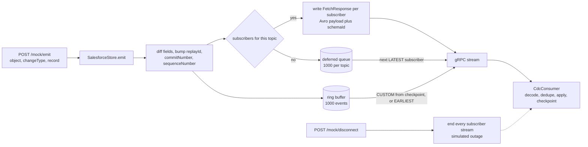

`/mock/emit` does more than publish: it **mutates the stored dataset** for `CREATE`, `UPDATE` and
`UNDELETE` and soft-deletes on `DELETE`, so a later bulk extract agrees with the events already sent. It
answers with the replay id (decimal and hex), `commitNumber`, `commitTimestamp`, `sequenceNumber`, the
computed field lists, and `{delivered, queued}`.

---

## 11. Testing topology

Vitest, one root config, one fork.

| Layer | Runs where | Touches | Files |
|---|---|---|---|
| Unit | in-process | no network: pure functions, mappers, zod schemas, rate limiter | `packages/*/src/**/*.test.ts`, `apps/*/src/**/*.test.ts`, `apps/web/test/{leads,api,mock}/**` |
| Integration | in-process, real dependencies | real Postgres (`TEST_DATABASE_URL` → `poc_crm_test`) and, for mock tests, the real in-memory store | `packages/core/src/*.test.ts`, `apps/worker/test/**`, `apps/salesforce-mock/src/rest.test.ts` |
| End-to-end | over HTTP inside the compose network | the **live** stack: `web`, `mcp`, `worker`, `salesforce-mock`, real Postgres | `apps/web/test/e2e/01…05.test.ts` |

Configuration that matters (`vitest.config.ts`): `pool: 'forks'` with `singleFork: true`, because tests
share one Postgres and one in-memory mock, so files run serially and each file must own the data it
asserts on — the mock's seed **replaces** by default. `testTimeout` and `hookTimeout` are 30 s and
`teardownTimeout` 120 s, because every E2E assertion polls a live process. The E2E suite needs the stack
already up with the schema applied, and never starts or restarts a service: it only talks HTTP, plus
`@poc/core` for cleanup because the API exposes no deletes.

### Tests are not hermetic against a running demo — they rewrite it

`globalSetup: ['apps/web/test/global-setup.ts']` runs **once for the whole run, after every file** and
restores the canonical demo state: `POST /mock/reset` plus `POST /mock/seed` with `CANONICAL_COUNTS =
{accounts:4, contacts:6, opportunities:6, leads:3}` (19 records), delete the CRM rows that mirror
Salesforce while **keeping landing-page leads**, one real bulk extract asserted at `19 read / 19 applied
/ 0 stale / 0 errors`, then drop leftover `E2E……/VITEST/TEST` rows and orphan links. A failure there
fails the run rather than leaving the demo half-restored.

So `pnpm test` against the stack you are demoing from does three visible things: every E2E file replaces
the mock dataset with the canonical demo rows plus its own, the Salesforce-sourced CRM rows are deleted
(and with them everything a previous `/mock/emit` had pushed them to), and a bulk extract runs.
Landing-page leads survive and `cdc_events` is cleared. Mid-demo, run the suite against a stack you can
discard.

---

## 12. Runbook index

`T=poc-local-token` (the value of `CRM_API_TOKEN`). Commands assume the repo root and the compose stack.

| Task | Command |
|---|---|
| Cold start | `docker compose up -d --build` |
| Apply the schema to `poc_crm` **and** `poc_crm_test` | `docker compose run --rm tools pnpm migrate` |
| Service state and health | `docker compose ps` |
| CRM API health including DB | `curl -s localhost:3000/api/health` |
| Worker control-plane health | `curl -s localhost:3002/health -H "authorization: Bearer $T"` |
| Bulk extract, synchronous | `curl -s -X POST localhost:3002/run/bulk -H "authorization: Bearer $T"` |
| Bulk extract, one-shot process | `docker compose run --rm worker pnpm --filter @poc/worker run start bulk` |
| Reconcile gap report | `curl -s -X POST localhost:3002/run/reconcile -H "authorization: Bearer $T"` |
| Emit a CDC UPDATE | `curl -s -X POST localhost:4000/mock/emit -H 'content-type: application/json' -d '{"object":"Opportunity","changeType":"UPDATE","record":{"Id":"006MOCK00004AAAYD2","StageName":"Closed Won","Amount":2600000}}'` |
| Emit a DELETE | same body with `"changeType":"DELETE"` and a record holding only `Id` |
| Simulate an outage, all topics | `curl -s -X POST localhost:4000/mock/disconnect -H 'content-type: application/json' -d '{}'` |
| Simulate an outage, one topic | `curl -s -X POST localhost:4000/mock/disconnect -H 'content-type: application/json' -d '{"topic":"/data/LeadChangeEvent"}'` |
| Force multi-page Bulk results | `curl -s -X POST localhost:4000/mock/config -H 'content-type: application/json' -d '{"queryJobPageSize":2}'` |
| Seed or reset the mock | `curl -s -X POST localhost:4000/mock/seed -H 'content-type: application/json' -d '{"mode":"replace"}'` then `curl -s -X POST localhost:4000/mock/reset` |
| Inspect failed CDC events | `docker compose exec -T postgres psql -U poc -d poc_crm -c "select event_id, object_name, change_type, replay_id, left(error,80) from cdc_events where status='failed';"` |
| Inspect checkpoints | `docker compose exec -T postgres psql -U poc -d poc_crm -c "select channel, replay_id, status, left(coalesce(error,''),60) from cdc_checkpoints order by channel;"` |
| Redrive failed events | `curl -s -X POST localhost:3002/run/redrive -H "authorization: Bearer $T" -H 'content-type: application/json' -d '{"limit":50}'` |
| Discard specific events | `curl -s -X POST localhost:3002/run/discard -H "authorization: Bearer $T" -H 'content-type: application/json' -d '{"event_ids":["/data/OpportunityChangeEvent:1795658187779043"]}'` |
| Watch the consumer | `docker compose logs -f worker` — look for `[cdc]`, `[cdc][RETRY]`, `[cdc][ALERT]`, `unblocked` |
| Full suite | `docker compose run --rm tools pnpm test` |
| E2E only | `docker compose run --rm tools pnpm exec vitest run apps/web/test/e2e` |
| E2E from the host | `E2E_HOST=localhost pnpm exec vitest run apps/web/test/e2e` |
| Typecheck every package | `docker compose run --rm tools pnpm typecheck` |
| Restart one service | `docker compose restart worker` |
| Nuke everything including `pgdata` and the named volumes | `docker compose down -v` |

Two facts the table implies but does not say: `restart: "no"` means nothing comes back by itself, and a
crashed **bulk** run leaves `sync_runs.status='running'` forever (only `cdc` runs are reaped). Fix it
with `UPDATE sync_runs SET status='failed' WHERE kind='bulk_extract' AND status='running';`.
